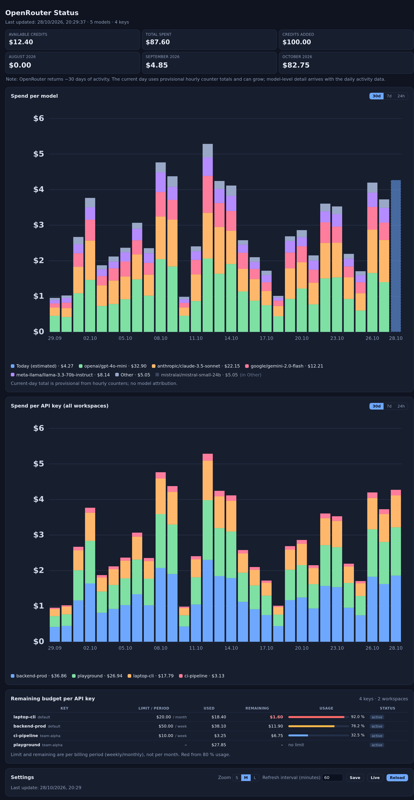

# OpenRouter Status

A small, dependency-free dashboard for your own OpenRouter account: credits, monthly
cost, spend per model / per API key, hourly bars for the last 24 hours and remaining
budget per key.

Runs as **one container** on the official `python:3.12-slim` image — no custom image, no
build step, no pip packages. Only the Python standard library is used, so updating the
container is just pulling a newer `python:3.12-slim` (Renovate config included).



## Why this exists

I built this purely because I like this condensed overview better than clicking through
several pages. **Everything it shows is also available in the OpenRouter dashboard** —
credits and usage under *Settings → Credits*, the activity breakdown under *Activity*, and
per-key limits under *Settings → API Keys*. This project is just a single page that puts
those numbers side by side (plus per-key remaining budget and hourly bars from local
sampling), so treat it as a convenience view, not as an additional source of truth.

## What it shows

- **Top row** – available credits, total spend, credits added, plus the cost of the last
  three calendar months (side by side).
- **Spend per model** – stacked bars over the last 30 days / 7 days / 24 hours.
  Max 6 colours per bar: top 5 by cost in the selected period plus a grey "Other"
  bucket; the legend lists up to 10 models.
- **Spend per API key** – same periods, per key across *all* workspaces; in the 24 h
  view it becomes an hourly stack per key.
- **Current day first** – today's spend shows up as soon as the local counter samples
  record it and grows with each 5-minute sample. Today's model split is estimated
  from the mix of the last completed days and drawn as a faded, dashed segment
  until OpenRouter reports the real day-level breakdown.
- **Remaining budget per API key** – limit, used, remaining and a usage bar per key, red from
  80 %; the limit interval (weekly/monthly) comes from OpenRouter's `limit_reset`.
- Reload (immediate fetch), Live (fetch + reload every 10 s), configurable refresh
  interval and S/M/L chart zoom.

## Data model

| file | content | retention |
|---|---|---|
| `data/hourly.json` | per hour: `total` (USD) and `keys` (USD per key) | `RETENTION_DAYS` (93) |
| `data/state.json` | last sampled cumulative counters (delta baseline) | – |
| `data/history.json` | daily aggregates per model / workspace / key from `/activity` | `RETENTION_DAYS` (93) |
| `data/config.json` | refresh interval set in the UI | – |

Every `SAMPLE_SECONDS` (default 300) the app reads the cumulative counters
(`/credits.total_usage` and each key's `usage`) and adds the difference to the running
hour bucket. Raw samples are not kept — hourly is the smallest granularity stored.
`/activity` only has a rolling ~30 day window and day resolution, which is why older
months accumulate locally and why per-model hourly data does not exist.

## API notes (learned the hard way)

- `GET /activity?api_key_hash=<hash>` is the **only** working per-key filter.
  `api_key`, `api_key_id`, `key_hash`, `key_id` are silently ignored and return the whole
  account — always compare filtered vs. unfiltered sums.
- `GET /keys` is workspace-scoped: iterate `?workspace_id=<id>` for every workspace,
  otherwise you only see the Default Workspace.
- `GET /activity` ignores `limit`, `cursor`, `start_date`, `offset` and `granularity`.
  `group_by` only accepts `workspace`.
- There is no ledger/billing/invoice endpoint (all 404).

## Quick start

```bash
git clone https://github.com/Valtheryx/openrouter-status.git
cd openrouter-status
cp .env.example .env          # add your OpenRouter management key
docker compose up -d
# open http://localhost:8097
```

Management key: <https://openrouter.ai/settings/management-keys> (a *management* key, not
a normal inference key).

### Behind Portainer / with absolute paths

When the compose file is deployed as a Portainer *string stack*, relative bind mounts
resolve against Portainer's own working directory, so use absolute paths:

```yaml
volumes:
  - /opt/docker/openrouter-status/app:/app:ro
  - /opt/docker/openrouter-status/data:/data
```

## Configuration

| env | default | meaning |
|---|---|---|
| `OPENROUTER_API_KEY` | – | management key (required) |
| `REFRESH_MINUTES` | `60` | activity refresh interval (UI can override) |
| `SAMPLE_SECONDS` | `300` | counter sampling interval for hourly bars |
| `RETENTION_DAYS` | `93` | retention for hourly + daily data |
| `TZ` | `Europe/Berlin` | timezone for day/hour buckets and labels |
| `PORT` | `8000` | listen port inside the container |
| `UI_LANG` | `en` | UI language (`en` or `de`; repo default is English) |

## Endpoints

`/` UI · `/api/data` merged payload · `/api/status` fetch state · `/api/health` probe ·
`POST /api/refresh` immediate fetch · `GET|POST /api/config` refresh interval.

## License

MIT — see [LICENSE](LICENSE).
